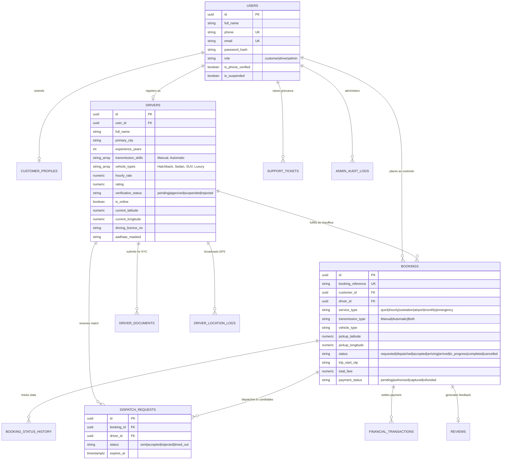

# Salman Driver – Production Database Architecture & Schema Documentation

> **Platform:** Pan-India On-Demand Personal Driver Marketplace  
> **Brand Promise:** *"Your Car. Your Journey. Our Drivers."*  
> **Core Principle:** Customers own their vehicles; verified professional drivers operate customers' vehicles on-demand.

---

## 1. Entity-Relationship Diagram (Mermaid)

---

## 2. Table Specifications & Security Model

| Table Name | Primary Key | Foreign Keys | Row Level Security (RLS) Policy |
| :--- | :--- | :--- | :--- |
| `users` | `id (UUID)` | None | Self read/write; Admin full access |
| `customer_profiles` | `user_id (UUID)` | `users(id)` | Customer read/write; Admin read |
| `drivers` | `id (UUID)` | `users(id)` | Public read approved; Driver self duty update; Admin full |
| `driver_documents` | `id (UUID)` | `drivers(id)` | Submitting driver & Admin only (Aadhaar & DL protected) |
| `service_areas` | `id (VARCHAR)` | None | Public read active; Admin write |
| `bookings` | `id (UUID)` | `users(id)`, `drivers(id)` | Customer & assigned driver read/write; Admin full |
| `booking_status_history` | `id (UUID)` | `bookings(id)` | Immutable append-only audit trail of transitions |
| `dispatch_requests` | `id (UUID)` | `bookings(id)`, `drivers(id)` | Targeted driver read/respond; Admin read |
| `driver_location_logs` | `id (BIGSERIAL)` | `drivers(id)` | Driver append; In-transit customer read; Admin read |
| `financial_transactions`| `id (UUID)` | `bookings(booking_reference)` | Customer/driver read own transactions; Admin full |
| `admin_audit_logs` | `id (UUID)` | `users(id)` | Admin read-only; System append-only |
| `support_tickets` | `id (UUID)` | `users(id)` | User read own; Admin read/write |
| `reviews` | `id (UUID)` | `bookings(id)`, `drivers(id)` | Public read approved; Customer insert; Admin moderate |
